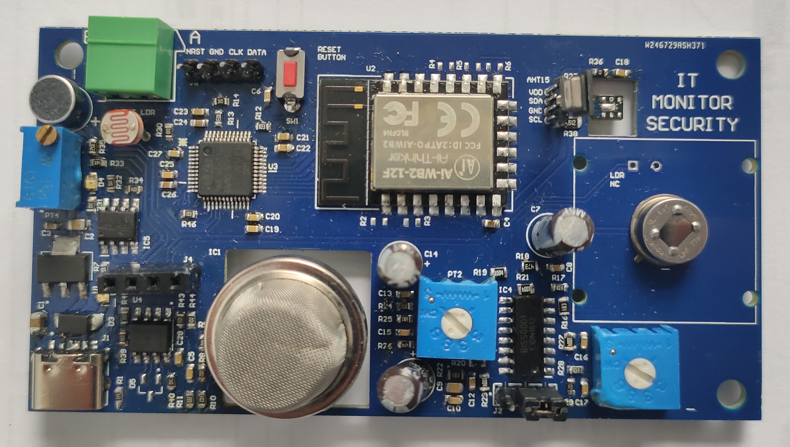
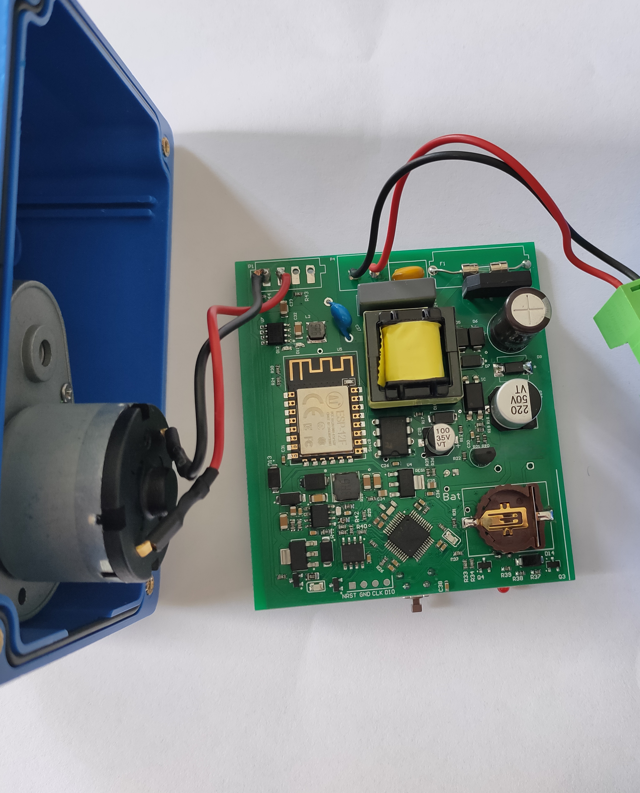

[← Home](index.html)

# Projects

Engineering solutions from concept to deployment.

<table>
  <thead>
    <tr>
      <th>Thumbnail</th>
      <th>Project</th>
      <th>Summary</th>
      <th>Tech</th>
    </tr>
  </thead>
  <tbody>
    <tr>
      <td valign="top">
        
      </td>
      <td valign="top">
        <strong>STM32-Based Synchronized Dual Encoder Motor Control &amp; RGBW Lighting System</strong>
         
        <a href="case-study.html">View Case Study</a>
      </td>
      <td valign="top">
        Designed an embedded control system for synchronized dual-motor operation, RF remote control, and RGBW lighting.
      </td>
      <td valign="top">
        STM32 · Embedded Firmware · Motor Control · Encoder Feedback · PCB Design · Wi-Fi · UART · RF · Ebyte LoRa · MOSFET
      </td>
    </tr>
    <tr>
      <td valign="top">
        
      </td>
      <td valign="top">
        <strong>IT Security Monitor – Multi-Sensor Environmental Monitoring System</strong>
         
        <a href="it-security-monitor.html">View Case Study</a>
      </td>
      <td valign="top">
        Designed and developed a custom STM32-based monitoring system integrating gas, light, motion, temperature, humidity, and sound detection. Implemented RS485-based device configuration and Wi-Fi data transmission to a server database.
      </td>
      <td valign="top">
        STM32 · C · Embedded Firmware · Circuit Design · PCB Design · UART · RS485 · Wi-Fi · MQ-135 · LDR · PIR · AHT15 · Microphone · USB Type-C
      </td>
    </tr>
    <tr>
      <td valign="top">
        
      </td>
      <td valign="top">
        <strong>Drain Pump – Programmable Pump Control System</strong>
         
        <a href="drain-pump.html">View Case Study</a>
      </td>
      <td valign="top">
        Developed an STM32-based programmable pump control system with separate weekday and weekend schedules, Wi-Fi mobile application control, and power-loss data preservation using a voltage-fall interrupt and Flash storage. The project was approved by Diversey.
      </td>
      <td valign="top">
        STM32 · Embedded C · Flash Memory · Interrupt Handling · Wi-Fi · UART · Power Supply Design · TPS54331 · PCB Design
      </td>
    </tr>
  </tbody>
</table>
