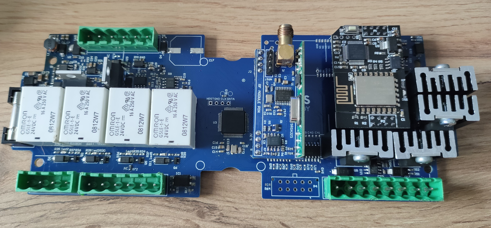

[← Home](index.html)

# Projects

Engineering solutions from concept to deployment.

<table>
  <thead>
    <tr>
      <th>Thumbnail</th>
      <th>Project</th>
      <th>Summary</th>
      <th>Tech</th>
    </tr>
  </thead>
  <tbody>
    <tr>
      <td valign="top">
        
      </td>
      <td valign="top">
        <strong>STM32-Based Synchronized Dual Encoder Motor Control &amp; RGBW Lighting System</strong>
         
        <a href="case-study.html">View Case Study</a>
      </td>
      <td valign="top">
        Designed an embedded control system for synchronized dual-motor operation, RF remote control, and RGBW lighting.
      </td>
      <td valign="top">
        STM32 · Embedded Firmware · Motor Control · Encoder Feedback · PCB Design · Wi-Fi · UART · RF · Ebyte LoRa · MOSFET
      </td>
    </tr>
  </tbody>
</table>
